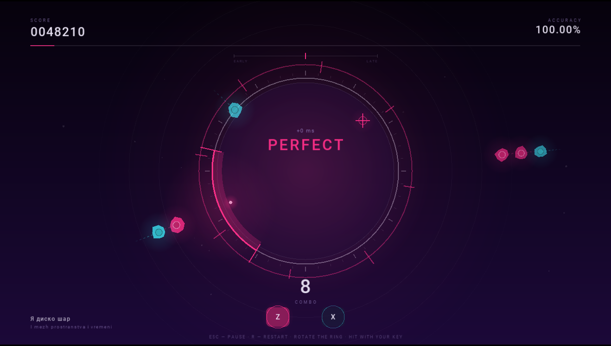
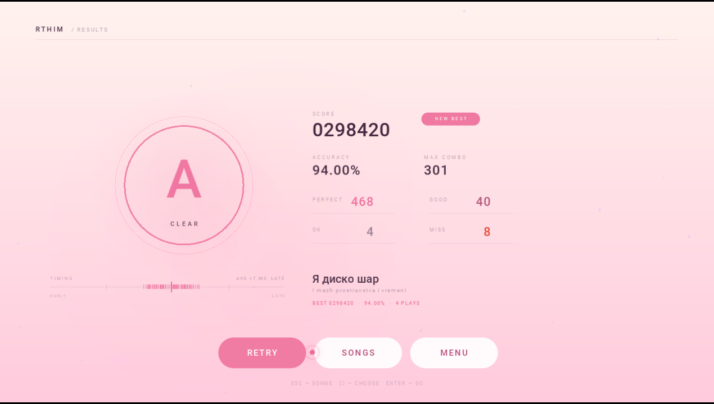
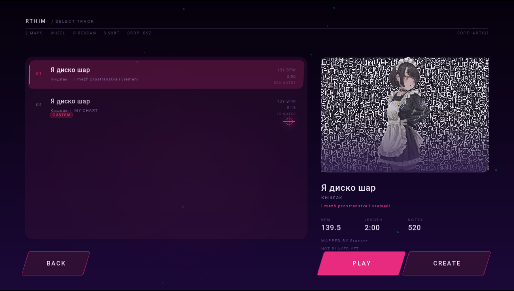
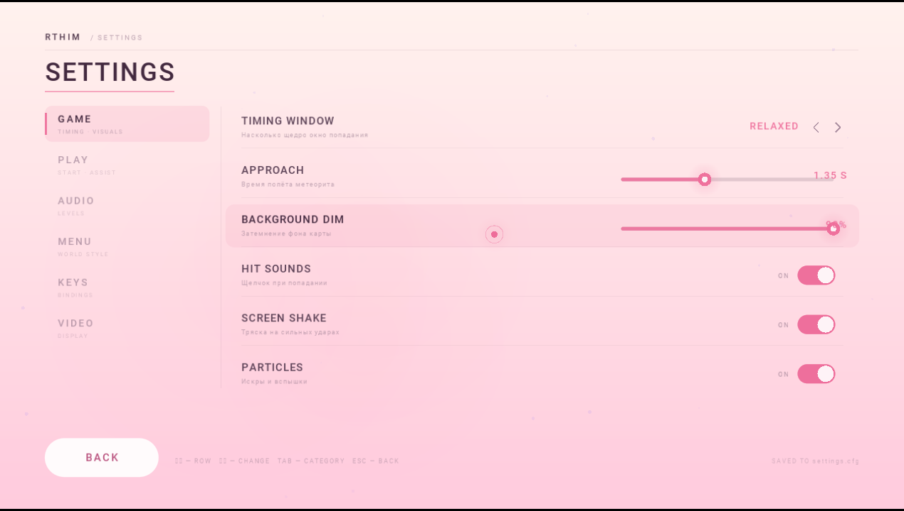
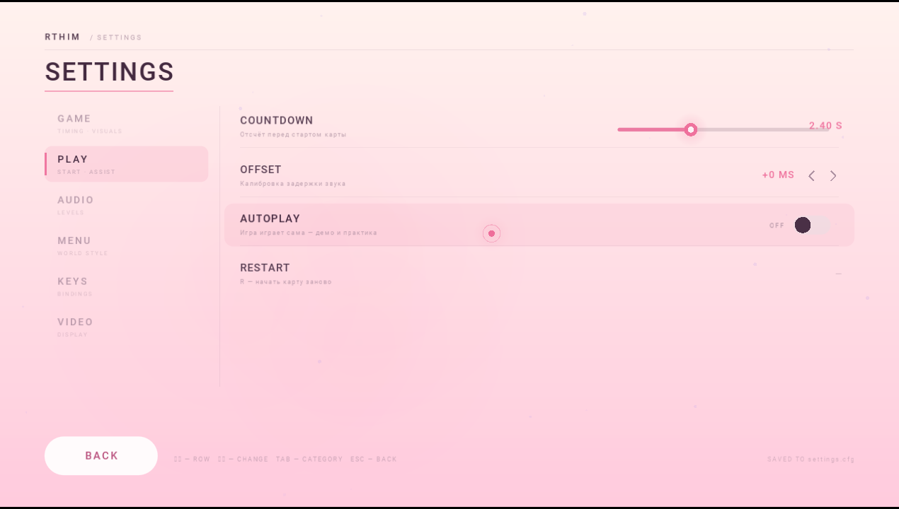
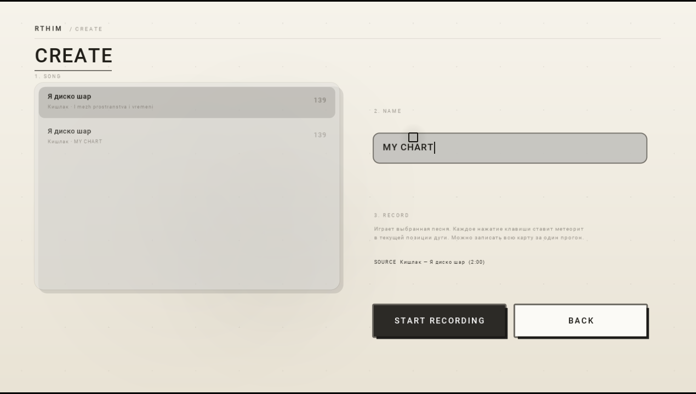
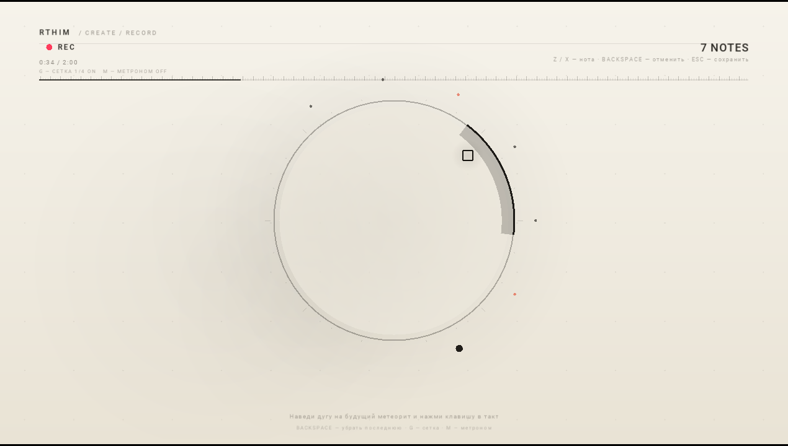

# rthim

Ритм-игра на C++ с собственным рендером и процедурной музыкой. Главное меню
морфится от положения курсора: слева неон, в центре пастель, справа бумажный
брутализм; перетекают цвета, формы, фон, курсор и музыка. Из меню можно выбрать
карту, сыграть её, настроить игру, посмотреть личные рекорды или записать
собственную карту.

| NEON | BLOOM | INK |
| --- | --- | --- |
|  |  |  |

## Как играть

В центре экрана — кольцо, по которому ходит **активная дуга**. Она смотрит
туда, куда показывает курсор: двигай мышь по кругу и наводи дугу.

К кольцу с разных сторон летят метеориты двух цветов. Когда метеорит
долетает до кольца:

- наведи на него дугу;
- нажми **Z** (первый цвет) или **X** (второй цвет).

Точность попадания даёт разное количество очков: PERFECT / GOOD / OK. Чуть
раньше или позже — не страшно, но очков меньше. Промах рвёт комбо и даёт MISS.
Если нажать не ту клавишу или не навести дугу — метеорит пролетит мимо.

Сверху под полосой песни есть **шкала тайминга**: розовая риска показывает
последнее попадание (рано/поздно), голубая — средний сдвиг. По ней удобно
ловить, что ты систематически жмёшь раньше или позже, и подкручивать offset.

| Геймплей | Результаты |
| --- | --- |
|  |  |

В начале карты идёт отсчёт (0.5–6 секунд, настраивается): первый метеорит
успевает подлететь ещё до старта песни. Игровое время берётся из аудиочасов
(`sample_position`), поэтому ноты не уплывают относительно музыки.

- **ESC** — пауза (RESUME / RESTART / QUIT); на паузе видны очки, точность и комбо;
- **R** — сразу начать карту заново;
- **− / +** — общая громкость в любой момент;
- **F11** — полноэкранный режим.

## Рекорды и тайминг

Лучший результат каждой карты хранится в `scores.cfg`: очки, точность, максимальное
комбо, число прогонов и дата. Рекорд виден в карточке карты в списке, а на
результатах появляется плашка **NEW BEST** и строка `BEST ...`. В последний раз
сыгранная карта автоматически выбирается при следующем запуске.

На экране результатов под оценкой — **облако тайминга**: каждое попадание
отмечено риской, отдельно показан средний сдвиг и вердикт EARLY / LATE. Это
быстрый способ откалибровать offset под свои наушники и реакцию. Автоплей
рекорды не записывает.

## Карты

Поддерживаются обычные `.osz` из osu! (mode 0): ZIP + `.osu` + аудио + фон.
Кружки и слайдеры превращаются в метеориты, спиннеры пропускаются. Угол
метеорита — направление ноты относительно центра поля osu!, клавиша — тип
объекта: кружок → Z, слайдер → X. BPM и offset берутся из тайминг-поинтов,
длительность и сложность — из метаданных.

- положи `.osz` в `songs/` или просто перетащи файл в окно игры;
- можно распаковать `.osz` в любую папку внутри `songs/` — игра найдёт `.osu`
  рекурсивно и подхватит аудио и фон рядом с ним;
- в меню выбери **PLAY / TRACKS**, затем карту и **PLAY**;
- **R** в списке — пересканировать папку, **S** — сортировка
  (ARTIST / TITLE / BPM / LENGTH / RECENT);
- самодельные карты из `songs/custom/` помечены чипом **CUSTOM** и сортируются
  вместе со всеми.

| Выбор карты | Настройки: GAME | Настройки: PLAY |
| --- | --- | --- |
|  |  |  |

Обложка и аудио извлекаются в `.cache/` при первом выборе карты; повторный
запуск ничего не распаковывает. Аудио декодируется полностью в память
(MP3 через mpg123, WAV — свой парсер) и приводится к 48 кГц stereo float.

## Создание карт

**CREATE** — запись карты в один прогон:

1. выбери песню из уже загруженных карт;
2. введи название (клик по полю, Enter — закончить ввод);
3. **START RECORDING** — пойдёт выбранная песня;
4. наводи дугу и жми Z / X в такт: каждое нажатие ставит метеорит в текущей
   позиции дуги;
5. **ESC** или конец песни — сохранение.

При записи работает сетка **1/4 доли** (клавиша **G**): время ноты подтягивается
к ближайшей доле, если промах не больше 120 мс. **M** включает метроном —
тихий щелчок на каждую долю. **Backspace** убирает последнюю ноту, а на
таймлайне видны доли и такты песни, так что карта получается ритмичной даже
при записи «на слух».

Карта пишется в `songs/custom/<имя>/` как обычный `.osu` + копия аудио, сразу
появляется в списке и играется тем же движком.

| Создание | Запись |
| --- | --- |
|  |  |

## Настройки

Шесть разделов, всё сохраняется в `settings.cfg` сразу при изменении:

- **GAME** — окно попадания (RELAXED / NORMAL / STRICT), время подлёта
  метеорита, затемнение фона, звук удара, тряска, частицы;
- **PLAY** — отсчёт перед стартом, offset (калибровка задержки звука), AUTOPLAY
  (игра играет сама — демо и практика);
- **AUDIO** — общая громкость, музыка, эффекты;
- **MENU** — как живёт мир меню: за курсором, авто-смена или фиксированный;
  скорость автосмены;
- **KEYS** — раскладка двух клавиш: Z/X, D/F, J/K, A/L;
- **VIDEO** — полноэкранный режим.

Управление: ↑↓ — строка, ←→ — значение, Tab — раздел, мышь — клик/перетаскивание
ползунка, колесо — значение под курсором, ESC — назад. В меню колесо по-прежнему
меняет общую громкость; **− / +** и **F11** работают на любом экране.

## Звук меню

Три бита синтезируются на месте, без файлов: NEON — 128 BPM, BLOOM — 96 BPM,
INK — 88 BPM (бочка, снейр, хэт, бас, лид, пэд, винил). Все секвенсоры идут по
общей сетке шестнадцатых: шаг один, темп — взвешенное среднее BPM миров и
ползёт плавно, а тембры кроссфейдятся. Поэтому при смене мира ритмы не
наезжают друг на друга.

Уровни берутся из аудиопотока: огибающая бочки гонит пульс интерфейса, три
полосы (низ/середина/верх) — столбики эквалайзера. Если устройства нет, меню
живёт на синтетическом пульсе. На игровых экранах процедурные биты замолкают,
играет песня карты.

```bash
./build/rthim --bounce   # три WAV по 8 секунд в /tmp/opencode/rthim_*.wav
```

## Интерактив главного меню

- **Эквалайзер** — клик по столбику включает/выключает полосу.
- **Медальон мира** — клик переключает мир, перетаскивание крутит вручную.
- **Шкала миров** внизу — клик или перетаскивание ползунка.
- **Четыре доли** — клик перезапускает такт.
- **PLAY / TRACKS** — выбор карты, **SETTINGS** — настройки, **QUIT** — выход.
- Подсказки появляются под курсором; кнопки пружинят, продавливаются и дают рябь.

## Сборка

Нужны: C++20, CMake ≥ 3.20, SDL3, SDL3_ttf, zlib, libmpg123 (dev-пакеты).

```bash
cmake -S . -B build
cmake --build build
./build/rthim
```

Полезные флаги для разработки:

```bash
./build/rthim --shot      # 5 кадров меню в /tmp/opencode/menu_*.png
./build/rthim --shots     # все экраны: select/settings/create/record/play/pause/results
./build/rthim --selftest  # тестовая карта, парсинг, рекорд и сетка записи
./build/rthim --autoplay  # 12 секунд встроенного автоплея (проверка тайминга)
./build/rthim --list      # список карт, сортировки и рекорды в консоль
```

`--shots`, `--selftest` и `--autoplay` пишут только в `/tmp` и `songs/custom`
(каталог создаёт только `--selftest`).

## Устройство

```
src/
├── main.cpp       — окно, события, цикл, флаги --shot/--shots/--selftest/--autoplay/--list
├── app.hpp/.cpp   — состояние приложения, экраны, ввод, запуск карт, сохранение
├── screens.hpp/.cpp — отрисовка выбора/настроек/создания/результатов/паузы
├── gameplay.hpp/.cpp — кольцо, дуга, метеориты, тайминг, счёт, HUD
├── beatmap.hpp/.cpp  — ZIP (zlib) + парсер .osu + извлечение файлов
├── song.hpp/.cpp     — MP3 (mpg123) / WAV → 48 кГц float, аудиочасы и SFX
├── mapdb.hpp/.cpp    — список карт, кэш, обложки (stb_image)
├── scores.hpp/.cpp   — лучшие результаты и статистика прогонов (scores.cfg)
├── settings.hpp/.cpp — модель настроек и settings.cfg
├── settings_ui.hpp/.cpp — строки экрана настроек
├── paths.hpp/.cpp    — корень проекта, songs/, .cache/, scores.cfg
├── gfx.hpp/.cpp      — мини-рендерер: скруглённые прямоугольники со скосом,
│                       свечения, кольца, дуги, полигоны, текст, текстуры, клип
├── theme.hpp         — три стиля и правила их смешивания
├── audio.hpp/.cpp    — процедурные биты меню, кроссфейд, уровни и пульс
├── menu.hpp/.cpp     — раскладка и анимации главного меню
└── ui.hpp/.cpp       — общие виджеты остальных экранов
```

Логическое полотно — 1280×720 с letterbox-масштабированием. Фигуры копятся в
один вершинный буфер и уходят в `SDL_RenderGeometry` пачкой; текст и текстуры
вызывают `flush()`, чтобы слои шли в правильном порядке.

## Что дальше

- Несколько сложностей из одного `.osz` и превью песни в списке.
- Больше механик: удержания, двойные метеориты, длинные слайдеры.
- Отдельный экран калибровки offset'а с метрономом.
- Редактор с таймлайном: перетаскивание и удаление нот, зум, несколько дуг.

## Шрифты и сторонний код

`assets/fonts/Roboto-{Regular,Medium}.ttf` — Roboto, Apache 2.0
(см. `assets/fonts/NOTICE.txt`). `third_party/stb_image.h` — stb_image,
public domain / MIT.