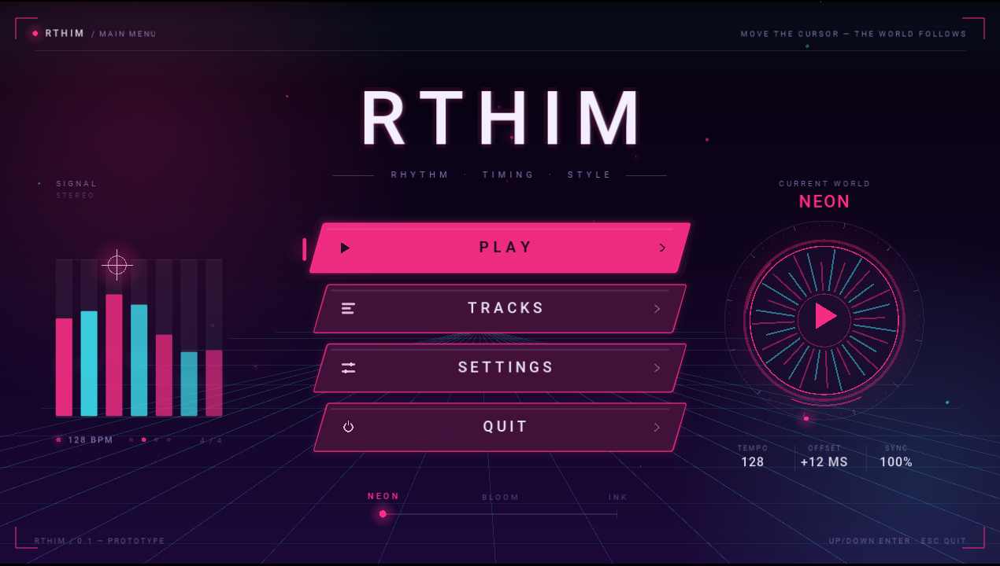
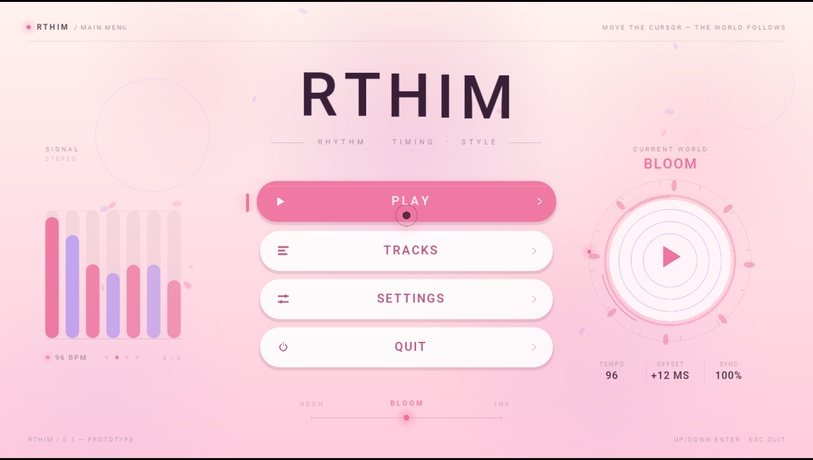
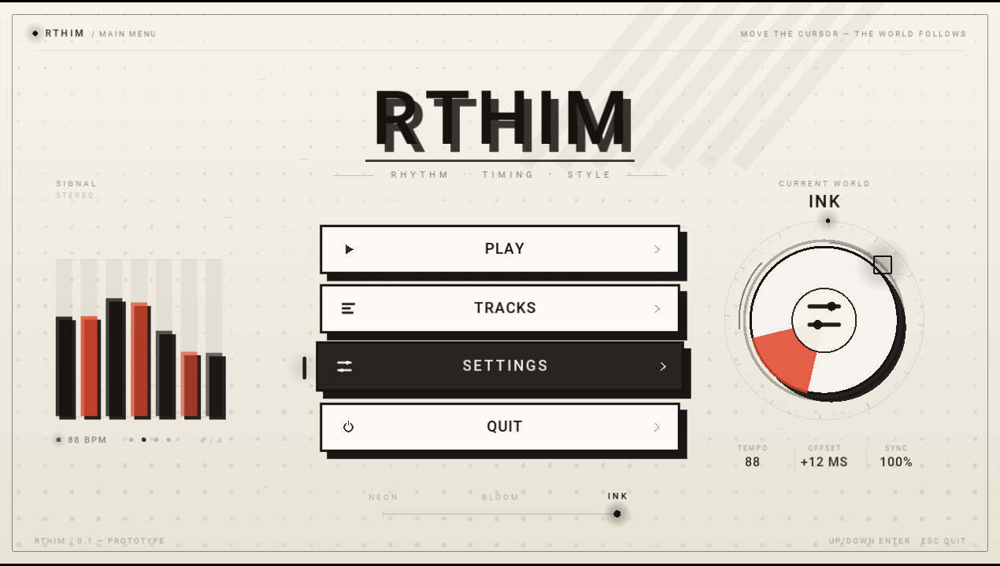

# rthim

Ритм-игра на C++ — пока только главное меню, но уже со звуком. Идея меню:
стилистика интерфейса зависит от положения курсора. Слева — неон, в центре —
пастель, справа — бумажный брутализм; между ними всё перетекает: цвета,
форма кнопок, тени, фон, курсор и даже музыка. У каждого мира свой бит, и
интерфейс бьётся в его удары.

| NEON | BLOOM | INK |
| --- | --- | --- |
|  |  |  |

### Композиция

Экран держится на трёх колонках: слева живой «сигнал» (эквалайзер с BPM),
в центре — заголовок и пункты меню, справа — медальон текущего мира с
выбранным действием, орбитой и показателями. Так кадр не распадается на
пустое поле вокруг кнопок.

### Звук

Три лупа синтезируются на месте, без файлов: NEON — 128 BPM (бочка в пол,
оффбит-хэт, злой бас, арп), BLOOM — 96 BPM (половинная бочка, шейкер,
колокольчики, пэд), INK — 88 BPM (бум-бэп, снейр, контрабас, роудс, винил).
Громкость лупов = веса стилей, поэтому переход между мирами — это кроссфейд.

Уровни берутся из самого аудиопотока: огибающая бочки гонит пульс интерфейса,
а три полосы (низ/середина/верх) — столбики эквалайзера. Если устройства нет,
меню живёт на синтетическом пульсе и продолжает работать.

```bash
./build/rthim --bounce   # три WAV по 8 секунд в /tmp/opencode/rthim_*.wav
```

### Анимации

- Мир меню догоняет курсор пружиной (без рывков и без «прилипания»):
  у каждого стиля есть плато, переход занимает узкую полосу.
- Курсор: собственная пружина + медленный светящийся след; над кнопкой
  меняет цвет на контрастный, чтобы не растворяться в акцентной заливке.
- Левая колонка: семь столбиков «сигнала» — реальные полосы бита, с жёсткой
  тенью в INK и свечением в NEON; рядом бегут четыре доли такта и BPM.
- Правая колонка: вращающиеся дуги, деления орбиты, точка на орбите, пульс
  диска; на удар от него расходится кольцо, спицы NEON вытягиваются, лепестки
  BLOOM разлетаются. Внутренности диска разные — спектр-спицы (NEON),
  лепестки и кольца (BLOOM), пластинка с красным сектором и этикеткой (INK).
  Иконка пункта подпрыгивает при смене выбора.
- Вход: буквы заголовка всплывают по одной, кнопки — каскадом снизу.
- Кнопки: подъём и лёгкое масштабирование при наведении, продавливание при
  клике, расширяющийся трекинг подписи, «дышащая» стрелка, бегущий индикатор
  выбора, рябь от точки нажатия.
- Фон живёт в каждом мире по-своему: неоновые искры, скан и редкие глитчи;
  пастельные лепестки, боке и кольца; бумажный полутон с волной, пыль и
  красное кольцо с точкой на орбите.
- Заголовок: покачивание букв (своя амплитуда у каждого стиля), пульс
  свечения, «дышащая» жёсткая тень, растущее подчёркивание.

## Сборка и запуск

Нужны: компилятор C++20, CMake ≥ 3.20, SDL3 и SDL3_ttf (dev-пакеты).

```bash
cmake -S . -B build
cmake --build build
./build/rthim
```

Отдельно: `./build/rthim --shot` — отрисует и сохранит пять кадров в
`/tmp/opencode/` (удобно для проверки внешнего вида без скриншотов экрана).

## Управление

- **Курсор** — перемещает мир меню между NEON / BLOOM / INK.
- **↑ / ↓** или **W / S** — выбор пункта, **Enter / Space** — нажать.
- **Esc** или **QUIT** — выход.

Пункты кроме QUIT пока показывают заглушку — это меню-демо.

## Устройство

```
src/
├── main.cpp    — окно, события, цикл, режим --shot
├── gfx.hpp/.cpp — мини-рендерер: скруглённые прямоугольники со скосом,
│                  свечения, кольца, дуги, эллипсы, полигоны, текст
│                  (SDL3_ttf), один вызов SDL_RenderGeometry на все фигуры
├── theme.hpp   — три стиля и правила их смешивания
├── audio.hpp/.cpp — процедурные биты, кроссфейд, уровни и пульс
└── menu.hpp/.cpp — раскладка, анимации, отрисовка меню
```

Рендер идёт в логическое полотно 1280×720 с letterbox-масштабированием под
любой размер окна. Все фигуры копятся в вершинный буфер и рисуются пачкой;
текст вызывает `flush()`, чтобы слои шли в правильном порядке.

## Что дальше

- Общий транспорт: `sample_position` аудиоустройства как единственный
  источник игрового времени (системные часы для ритма не подходят).
- Экран калибровки offset'а.
- Парсер `.osu` и одна песня для проверки «ощущения» нот.
- Редактор карт — без него контента не будет.

## Шрифты

`assets/fonts/Roboto-{Regular,Medium}.ttf` — Roboto, лицензия Apache 2.0
(см. `assets/fonts/NOTICE.txt`).